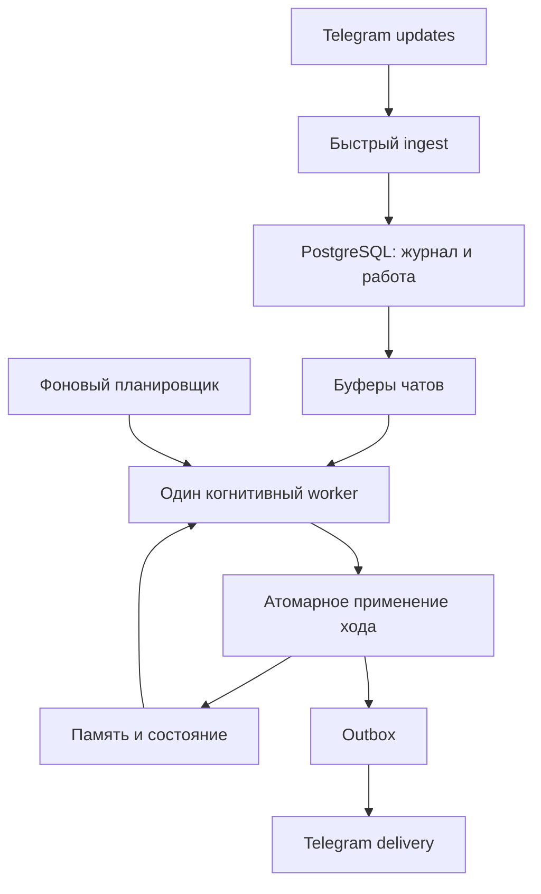

# Living Telegram Agent
## Architecture Specification v0.6

**Статус:** Draft — целевая архитектура, не отчёт о реализованном коде  
**Дата:** 2026-09-10  
**Предыдущая версия:** ARCHITECTURE_v0.5  
**Язык:** TypeScript  
**Развёртывание:** один постоянный Node.js-процесс на VPS, systemd  
**Telegram:** Bot API, long polling  
**Хранение:** PostgreSQL; pgvector подключается для семантического поиска  
**Модельный runtime:** собственный тонкий адаптер на OpenAI-совместимом протоколе (стартовый endpoint — OpenCode Go, запасной — OpenRouter); состояние и память принадлежат приложению  
**Внешние инструменты:** ограниченные web search / fetch

---

## Изменения решений

<!-- Формат: YYYY-MM-DD — раздел — что изменилось и почему. Новые записи сверху. -->

- 2026-10-21 — §12.1, §17 — по итогам ревью Harness (скилл developing-ai-agents, плейбук harness-review): (1) §12.1 — уточнено, что retry_wait означает растущую паузу между попытками, а не мгновенный повтор: иначе кратковременный сбой провайдера сжигает лимит попыток за секунды и превращает восстанавливаемый сбой в терминальный пропуск; (2) §17 — constraints передаются структурной секцией контекста, а не склейкой в system-строку: недоверенные данные не должны попадать в позицию инструкций. Остальные находки ревью — уровня реализации, разнесены пунктами в CHECKLIST (1.7–1.11, 2.7): инвариант «однократное применение» и бюджеты в §12.1/§16 уже сформулированы, код им пока не соответствует.

- 2026-10-21 — шапка, §17 — модельный runtime: адаптер Eve полностью убран, вместо него собственный тонкий адаптер на OpenAI-совместимом протоколе. Причины: Eve сырой, непрозрачная и кривая работа с контекстом, возможности почти не используются. Endpoint'ы из конфигурации: OpenCode Go (стартовый), OpenRouter (запасной). Без стриминга и автоматического fallback в MVP. Интерфейс CharacterModel не изменился; схема памяти, Telegram journal и recovery не затронуты.

---

# 1. Назначение и главный продуктовый цикл

Проект создаёт постоянного AI-персонажа в Telegram: собеседника с характером, памятью, меняющимся отношением к людям и миру, избирательным вниманием и ограниченной инициативой.

Входящее сообщение — социальное событие, а не автоматически задача. Персонаж может ответить, поставить реакцию, промолчать или вернуться к теме позднее. Помогать, быть тёплым и отвечать подробно тоже допустимо: отказ и грубость сами по себе не являются признаками характера.

Главный проверяемый цикл:

1. Персонаж встречает значимую тему в разговоре.
2. Сохраняет конкретное утверждение, опыт или впечатление с источником.
3. При необходимости изучает тему самостоятельно.
4. Формирует или уточняет отношение к ней.
5. Через несколько дней уместно вспоминает тему и основания своего отношения.
6. При новом опыте способен пересмотреть позицию, сохраняя понятную преемственность.

Приоритет — непрерывность опыта и индивидуальность. Задержки, несколько сообщений и реакции помогают выразить их, но не заменяют память.

## 1.1 Ограничения

- Один персонаж в первой версии; несколько личных и групповых чатов.
- Невысокая нагрузка; высокая конкурентность не является целью MVP.
- Без Redis, Kafka, внешней очереди, cron, микросервисов и serverless.
- Не строить полноценную психологическую модель человека.
- Не сохранять каждое существительное как сущность и каждую реплику как долговременную память.
- Не скрывать AI-природу персонажа и не придумывать фактически пережитую биографию.
- Не давать автономному исследованию неограниченные инструменты или бюджет.

# 2. Изменения относительно v0.5

| Было | Решение v0.6 | Причина |
|---|---|---|
| Отдельные knowledge, opinions, memories, thoughts | Типизированные записи единой памяти, связанные с entities | Общий поиск, источники, приватность и жизненный цикл |
| Отдельные CuriositySeed и Impulse | Одна таблица intentions | Один механизм отложенного действия |
| 8 параметров Psyche | Valence, arousal, socialEnergy | Меньше неоднозначной настройки |
| 5 параметров Relationship | Familiarity, affinity, trust + основания в памяти | Отделить численные регуляторы от конкретного опыта |
| Behavioral model → expressive model | Один структурированный ход по умолчанию | Снизить задержку и рассогласование |
| Параллельная когниция по чатам | Один глобальный когнитивный worker, порядок внутри чата | Последовательное общее состояние без сложной координации |
| Heartbeat и Maintenance как отдельные механизмы | Один фоновый планировщик с разными видами работы | Общие приоритеты и бюджеты |
| Память извлекается после закрытия эпизода | Значимые записи после хода; консолидация позже | Новое знание доступно сразу |
| Долгая Eve-сессия и session summary | Явная сборка контекста на каждый ход | Один источник истины |
| Privacy со второй фазы | Privacy с первого рабочего разговора | Исключить перенос контекста между чатами |
| Atomic deltas | Atomic deltas + идемпотентное применение turn | Защита и от гонок, и от повторного выполнения |
| Внутренний delivery key трактуется как идемпотентная доставка | Outbox + явный статус unknown | Не обещать exactly-once во внешнем API |
| Штраф за повторный recall | Подавление повторной инициативы по теме | Прямой вопрос всегда получает нужную память |

# 3. Архитектурные инварианты

1. Ingest не ждёт модели, инструментов, буфера или доставки.
2. Telegram offset продвигается только после надёжного сохранения update либо признания его уже сохранённым.
3. База — источник истины; таймеры и очереди в памяти восстанавливаются из неё.
4. Один когнитивный ход применяется к состоянию не более одного раза.
5. Принятое событие не теряется из-за сбоя модели; терминальный пропуск фиксируется явно.
6. Модель предлагает изменения и действия; runtime валидирует и разрешает их.
7. Изменения состояния могут применяться при ignore, react и defer.
8. Утверждение источника, интерпретация и предпочтение различимы.
9. Повторное вспоминание не является новым независимым доказательством.
10. Приватность проверяется до попадания данных в модель и повторно перед внешним действием.
11. Имена, алиасы, summaries, stances, intentions и запросы к web тоже могут содержать приватные данные.
12. Успешная запись собственного idempotency key не означает гарантированную однократную отправку в Telegram.

# 4. Пять логических модулей

| Модуль | Ответственность |
|---|---|
| Telegram | Polling, normalization, ingest, buffers, typing, reactions, outbox delivery |
| Character | Persona, mood, relationships, context assembly, TurnResult |
| Memory | Entities, memory items, links, stances, provenance, retrieval, consolidation |
| Background | Intentions, exploration, episodic summaries, cleanup |
| Runtime | Singleton, worker, scheduling, recovery, transactions, budgets, observability |

Это части одного приложения. Отдельные процессы или сервисы не требуются.



Polling и delivery работают независимо от когнитивного worker. Планировщик создаёт/активирует работу; сам не вызывает LLM параллельно с worker.

# 5. Процесс, конкурентность и жизненный цикл

## 5.1 Singleton

При запуске процесс получает PostgreSQL session advisory lock на отдельном постоянном соединении. Если lock занят — завершает запуск. При потере этого соединения процесс прекращает новые действия и завершается под перезапуск systemd: продолжать работу без singleton-защиты нельзя.

## 5.2 Один когнитивный worker

В каждый момент выполняется не более одного модельного задания персонажа, включая background cognition. Поэтому следующий ход читает уже применённые результаты предыдущего.

Приоритеты:

1. Прямое сообщение, reply, mention.
2. Значимое групповое обсуждение.
3. Готовое намерение ответить позже.
4. Исследование.
5. Консолидация и summary.

Внутри чата сохраняется порядок. Нельзя обработать позднее прямое обращение раньше значимого предшествующего batch того же чата: сначала обработать предшествующий либо явно включить его в объединённый ход. Между чатами применяется ограниченная справедливость, чтобы один чат не занимал worker бесконечно.

Очередь в памяти хранит ID. Не создавать неограниченную цепочку Promise с полными контекстами. Backlog остаётся в БД и подбирается ограниченными порциями.

Недостаток решения: долгий вызов задерживает остальные разговоры. Background выполняется короткими шагами; каждый внешний вызов имеет timeout. При появлении прямого обращения следующий фоновый шаг откладывается. Отмена текущего вызова используется только если адаптер её поддерживает; отменённый результат не применяется, возможная стоимость учитывается.

Конкурентность по чатам вводится только при измеренном росте задержки. Для неё потребуется отдельное решение о версиях общего состояния; одних row locks недостаточно для устранения устаревших модельных решений.

## 5.3 Startup и shutdown

Startup: подключить БД → получить singleton → загрузить конфигурацию → восстановить незавершённую работу → запустить polling, worker, scheduler и delivery.

Shutdown: остановить приём новой локальной работы → ограниченно дождаться текущих операций → сохранить доступные результаты → закрыть соединения. Recovery обязан работать и после SIGKILL; graceful shutdown не является условием корректности.

# 6. Telegram ingest и буферизация

## 6.1 Короткая транзакция ingest

Для каждого update:

1. Нормализовать тип и безопасно извлечь метаданные.
2. Начать транзакцию.
3. Вставить событие с UNIQUE(telegram_update_id); при конфликте подтвердить существование записи.
4. Для нового события сохранить raw update, текст/версию, chat/actor ID и status=pending.
5. Сохранить следующий poll offset в той же транзакции.
6. Commit; затем обновить offset в памяти и разбудить буфер.

Неподдерживаемые updates также фиксируются как journal_only/skipped, чтобы offset не застревал. При ошибке БД offset не продвигается и обработка последующих updates этой пачки прекращается до retry. Telegram updates обрабатываются в порядке update_id.

## 6.2 Буферы

Начальные настраиваемые значения:

| Сценарий | Idle window | Максимальное ожидание от первого события |
|---|---:|---:|
| Личка | 1–2 секунды | 3 секунды |
| Пассивная группа | 3–5 секунд | 6 секунд |
| Reply / mention / command | 0–300 мс | 1 секунда |

Дополнительно закрывать batch при 20 событиях или достижении лимита входного текста. Это стартовые настройки, не гарантии производительности.

Timer использует ближайшее из idle deadline и max deadline. Поток сообщений не может бесконечно переносить закрытие. Никакого await sleep внутри ingest.

При закрытии состав batch сохраняется транзакционно: создаётся turn с постоянным ID, а события связываются с ним. In-memory таймер можно потерять; принадлежность событий уже созданному turn — нельзя.

## 6.3 Prefilter

Дешёвые правила отделяют process от journal_only. Прямой запрос не отбрасывается как обычный group chatter. Низкосигнальные записи доступны в недавней истории, но не вызывают обязательный LLM и не становятся durable memory автоматически.

# 7. Persona и компактное состояние

## 7.1 Core persona

Версионированная конфигурация описывает манеру речи, ценности, границы, исходные интересы и допустимый стиль общения. Persona меняется явно, а не незаметно переписывается каждой репликой.

Если задана художественная биография, она маркируется как persona_seed. События реального runtime имеют другой источник. Персонаж не должен выдавать сгенерированные сцены за фактически пережитые взаимодействия.

Обязательные поведенческие установки:

- Не доказывать независимость отказами и грубостью.
- Не отвечать на всё только потому, что пришло сообщение.
- Не проговаривать механически внутренние параметры.
- Не выдумывать прежнее отношение или чтение статьи, которых нет в контексте.
- При отсутствии сформированного мнения допустим новый предварительный взгляд, без выдуманной предыстории.

## 7.2 Mood

```ts
interface Mood {
  valence: number;       // -1 .. 1
  arousal: number;       // 0 .. 1
  socialEnergy: number;  // 0 .. 1
  updatedAt: string;
}
```

При чтении вычисляется затухание к persona baseline:

```text
current = baseline + (stored - baseline) * exp(-lambda * elapsed)
next = clamp(current + validatedDelta)
```

Фоновый LLM для decay не нужен. Изменения ограничены на ход, допускается нулевой delta; значимое изменение требует source IDs и краткого основания. Значения half-life и максимальных deltas задаются конфигурацией и калибруются на диалогах.

Текстовое представление mood строится детерминированно. Конкретная обида или радость хранится как память/отношение к предмету, а не только как глобальное число.

## 7.3 Отношения с людьми

```ts
interface Relationship {
  personEntityId: string;
  scopeId: string;
  familiarity: number; // 0 .. 1
  affinity: number;    // -1 .. 1
  trust: number;       // 0 .. 1
  updatedAt: string;
}
```

Familiarity растёт преимущественно от значимых взаимодействий по runtime-правилу. Affinity и trust меняются ограниченно, со ссылками на основания. Они не сбрасываются с тем же decay, что настроение.

Отношения — специализированное состояние для person; «доверие к празднику» не вводится. Общее мнение о человеке может дополнительно находиться в stances, но числовая affinity принадлежит только Relationship, без дублирующего ползунка.

MVP хранит relationship по chat scope. Глобальная связь Telegram actor → person допустима внутри runtime, но история лички не становится основанием публичной характеристики человека. Объединение отношений между чатами откладывается до явной политики разрешённых проекций.

# 8. Единая память: что именно объединяется

Единый формат означает общий способ хранения, поиска, ссылок на источники и проверки доступа. Он не стирает различия между видами знания.

## 8.1 Entities

```ts
type EntityKind = 'person' | 'topic' | 'place' | 'object' | 'event' | 'project';
interface Entity {
  id: string;
  kind: EntityKind;
  canonicalName: string;
  scopeId: string;
  createdAt: string;
}
```

Примеры: Новый год как topic, конкретная вечеринка как event, человек как person, его игра как project.

Entity — идентификатор предмета памяти. Описания, спорные атрибуты и оценки сохраняются записями памяти, а не одним бесконтрольно перезаписываемым description.

Имена и алиасы тоже имеют область доступа. Публичная сущность может быть связана с приватными записями; приватная сущность не раскрывается через результаты поиска названий.

## 8.2 Memory items

```ts
type MemoryKind = 'claim' | 'experience' | 'thought' | 'preference';
type MemoryStatus = 'active' | 'disputed' | 'superseded' | 'retracted';
interface MemoryItem {
  id: string;
  kind: MemoryKind;
  text: string;
  provenanceId: string;
  salience: number;          // 0 .. 1: значимость, не истинность
  confidence?: number;      // только для проверяемых утверждений
  occurredAt?: string;
  recordedAt: string;
  validFrom?: string;
  validUntil?: string;
  status: MemoryStatus;
  supersedesId?: string;
}
```

| Вид | Смысл | Пример |
|---|---|---|
| claim | Утверждение источника о мире | «Источник S сообщает X за период P» |
| experience | Зафиксированное событие работы персонажа | «Обсуждал X с пользователем», «прочитал материал S» |
| thought | Интерпретация или ассоциация | «Эта история усиливает моё неприятие праздничной суеты» |
| preference | Относительно устойчивый вкус | «Нравятся тихие домашние праздники» |

Чужая история хранится как «человек рассказал X», а не «я пережил X». Внешний текст не повышается до факта только из-за уверенной формулировки. У предпочтения нет confidence истинности; его устойчивость описывается в stance.

## 8.3 Связи

`memory_links(memory_id, entity_id, role)` связывает одну запись с несколькими объектами: участник, предмет, место, контекст. Поэтому событие не копируется в карточку каждого участника.

`memory_sources(memory_id, source_id)` и `memory_derivations(derived_id, input_memory_id)` сохраняют основания и производность. Источником может быть journal event, web document, runtime action или версия persona. Ссылки на источники назначает и проверяет runtime; модель не может сослаться на несуществующее посещение сайта.

Начальный поиск связей ограничивается прямыми ссылками. Универсальный граф рассуждений и рекурсивный обход не нужны.

## 8.4 Stances: текущее отношение

```ts
interface Stance {
  id: string;
  entityId: string;
  aspect: string;            // например, atmosphere или road_safety
  scopeId: string;
  summary: string;
  strength: number;          // 0 .. 1: устойчивость позиции, не истинность
  interest: number;          // 0 .. 1: желание возвращаться к теме
  basisMemoryIds: string[];
  updatedAt: string;
  revision: number;
}
```

Одна сущность может иметь несколько аспектов. Противоречивые впечатления допустимы: нравится атмосфера праздника, не нравится шум.

Stance — компактное текущее представление, которое обновляется из памяти. Изменение сохраняется с основаниями и revision; предыдущие основания не стираются. Пересмотр может происходить из нового опыта либо новой интерпретации старого, но причина различается в журнале.

Не требуется отдельный sentiment score на каждый объект: текст, сила позиции и интерес достаточны до появления конкретного сценария для дополнительного поля.

## 8.5 Идентичность и пределы роста

- Новая entity создаётся при повторяемости, значимости, устойчивом интересе или необходимости будущего действия.
- Одноразовые бытовые упоминания могут остаться только в journal.
- Для person Telegram ID — сильный идентификатор; совпадение имён не является доказательством.
- Для остальных типов сначала scoped exact name/alias, затем ограниченный поиск кандидатов.
- При неоднозначности не объединять автоматически.
- Merge сохраняет прежние IDs/aliases и переносит связи транзакционно, не расширяя доступ.
- В MVP merge допускается как обслуживающая операция; отдельный LLM-resolver на каждое существительное не нужен.

# 9. Источники, приватность и производные данные

## 9.1 Политика MVP

Разрешены scope `public`, `chat:<id>`, `internal`. Пользовательские сообщения по умолчанию доступны только в исходном чате. Группа не равна public. DM-факт не переносится в группу даже при присутствии того же пользователя.

Перечень разрешённых аудиторий производного объекта вычисляется как пересечение разрешений его источников. Scope нельзя трактовать как линейную шкалу «самый строгий»: две разные приватные аудитории могут вообще не иметь общего разрешённого чата. В таком случае результат становится internal.

Missing/invalid provenance → internal. Расширение доступа требует явной валидированной операции. Модель предлагает связи с источниками, но не назначает себе разрешения.

## 9.2 Где проверяется доступ

До извлечения текста и до semantic ranking ограничивается набор доступных записей. Проверяются также:

- entities и aliases;
- relationship и stance summaries;
- episode summaries;
- intentions и их причины;
- tool results и search queries;
- собственные предыдущие сообщения, если они входят в контекст другого назначения.

Сначала собрать общую карточку из приватных и публичных записей, а потом удалить пару полей — недопустимо. Карточка собирается сразу для конкретной аудитории. Кэш ключуется scope и инвалидируется при изменении/удалении оснований.

В обычном объединённом ходе нет режима «модель увидела секрет, но обещает не сказать». Вся память, попавшая в этот ход, должна быть допустима для его чата. Internal reflection может работать отдельно, но его производные результаты наследуют ограничения.

Глобальное mood допустимо как грубое общее состояние без конкретных имён и причин. Полная информационная изоляция настроения между чатами не обещается; содержательная память и основания отношений изолируются.

## 9.3 Веб и приватность

Публичная доступность страницы не означает истинность всех утверждений и разрешение безусловно распространять персональные данные. Privacy scope и оценка надёжности источника — разные атрибуты.

Приватный разговор не отправляется в web search. Runtime разрешает только абстрагированный запрос без приватных имён, цитат, адресов и идентификаторов. Если безопасное абстрагирование неочевидно — автономное исследование пропускается. Query проходит gate до сетевого вызова.

# 10. Запись, обновление и извлечение памяти

## 10.1 Запись после хода

TurnResult может предложить ограниченный набор новых entities, memory items, stance revisions и intentions. Начальный предел: до 5 memory candidates и 2 намерений на ход; значения конфигурируемые.

Runtime проверяет типы, ссылки, scope, длины, дубликаты и допустимость изменений. Временные candidate IDs разрешаются в постоянные IDs внутри транзакции; неизвестные ссылки отклоняются. Прошедшие проверку записи становятся доступными следующему ходу сразу.

Не требуется отдельный extraction-вызов после каждого ответа. Если candidate не прошёл проверку, исходное событие остаётся в journal для последующей обработки. Не следует сохранять «ага», emoji и собственный ответ повторно как новое внешнее доказательство.

## 10.2 Консолидация

Фоновая работа объединяет дублирующиеся формулировки, связывает противоречия, создаёт краткие episode summaries и актуализирует stances. Она не делает source_deleted снова активным и не превращает предположение в подтверждённый факт.

Начальная граница эпизода: 4 часа тишины в DM, 1 час в группе или 100 событий. Это граница summary, а не задержка появления памяти.

## 10.3 Противоречия и самоподтверждение

Новое противоречащее утверждение сохраняется с отдельным источником. Старое может стать disputed/superseded; тихая перезапись запрещена. Важны период и территория применимости утверждения.

Повторный recall, повторная генерация summary и повторное чтение того же источника не добавляют независимого подтверждения. URL, content hash и известная связь перепечаток помогают дедупликации, но не гарантируют независимость разных публикаций. Модель не должна увеличивать confidence только потому, что «в памяти об этом много записей».

Повторное обсуждение может увеличивать актуальность темы и интерес к ней, но не истинность утверждения.

## 10.4 Retrieval

1. Определить аудиторию и доступные scopes.
2. Найти entities по названиям, aliases и контексту последних сообщений.
3. Получить актуальные stances и связанные записи.
4. При недостатке — full-text search; pgvector добавить для семантического поиска.
5. Ранжировать по релевантности, времени, значимости и разнообразию оснований.
6. Собрать компактную карточку с источниками в пределах token budget.

При прямом вопросе «что думаешь про X» приоритет имеют stance по X и его основания. Недавнее использование этой памяти не является основанием её скрыть. Подавление повторов применяется к инициативным упоминаниям, отдельно от retrieval.

Если сформированного отношения нет, модель может сказать это или сформировать предварительное впечатление из текущего контекста. Нельзя изображать многолетнюю позицию.

## 10.5 Забывание

Снижение salience уменьшает вероятность самопроизвольного воспоминания. Оно не удаляет автоматически важный источник и не означает ложность записи. Физическое удаление следует retention/deletion policy. Устаревшие планы получают expiry, а знания — статус актуальности, если есть основания.

# 11. Один модельный ход

## 11.1 Контекст

Перед вызовом собираются:

1. Core persona и runtime constraints.
2. Текущий batch либо цель фоновой работы.
3. Краткое текущее mood.
4. Разрешённые отношения с релевантными участниками.
5. Последние сообщения текущего чата.
6. Карточки релевантных сущностей: stances, memories, основания.
7. Актуальное намерение, если именно оно вызвало ход.

В группе контекст учитывает нескольких участников batch, а не только last actor. Частные отношения с ними из других чатов не подставляются.

У каждой секции есть лимит. Сначала исключаются слабые ассоциации, нерелевантные записи и старая история. Текущий batch и hard constraints сохраняются. Если batch слишком велик, он ограничивается на этапе формирования, а не бесконтрольно обрезается после генерации решения.

## 11.2 Контракт результата

```ts
type Action = 'ignore' | 'react' | 'speak' | 'defer';
interface TurnResult {
  action: Action;
  messages: Array<{ text: string }>;
  reaction?: {
    targetEventId: string;
    intent: 'laugh' | 'love' | 'approve' | 'shock' | 'sad' | 'angry';
  };
  stateChanges: {
    mood?: {
      valence: number;
      arousal: number;
      socialEnergy: number;
      sourceIds: string[];
      reason: string;
    };
    relationships: Array<{
      personEntityId: string;
      affinityDelta: number;
      trustDelta: number;
      sourceIds: string[];
      reason: string;
    }>;
  };
  entityCandidates: unknown[];
  memoryCandidates: unknown[];
  stanceChanges: unknown[];
  intentionCandidates: unknown[];
}
```

`unknown[]` в этом обзорном интерфейсе обозначает отдельные закрытые Zod-схемы соответствующих сущностей из разделов 8 и 14, а не разрешение принимать произвольный JSON. Реализация обязана использовать типизированные discriminated unions и ограничения размеров.

Значения внутри mood в stateChanges — deltas, не абсолютное новое состояние. Абсолютная перезапись состояния моделью запрещена.

Правила результата:

- ignore/defer не содержат отправляемых messages.
- react содержит допустимую reaction.
- speak содержит 1–4 сообщения; необязательная reaction разрешена.
- defer требует валидного reply_later намерения с notBefore; иначе становится ignore.
- Значимые изменения должны иметь доступные данному ходу основания.
- Runtime ограничивает дельты, объёмы и доступ, а не исполняет JSON напрямую.

При недоступности нужной reaction runtime пропускает её; не создаёт дополнительный LLM-вызов ради выбора emoji.

## 11.3 Runtime finalizer

До LLM проверяются известные ограничения: выключенный чат, режим mute, бюджет, невозможность отправки, proactive cooldown. После LLM повторно проверяются текущая политика, ссылки, schema, лимиты и приватность.

Runtime может подавить отправку, сохранив валидные изменения памяти/состояния. При ошибочном обязательном формате результат не применяется; допустим один ограниченный repair/retry. После исчерпания попыток turn получает failed/skipped с причиной, а система продолжает приём событий.

Отдельная дешёвая behavioral model может вернуться позднее, если измерения покажут экономию на группах без потери качества. Она не является базовым требованием v0.6.

# 12. Применение хода и recovery

## 12.1 Состояния turn

```text
queued → running → result_ready → applied
                  ↘ retry_wait → running
                  ↘ failed
```

retry_wait — пауза перед следующей попыткой, растущая с её номером (экспоненциальная). Повтор без задержки сжигает лимит попыток за секунды при кратковременном сбое провайдера и превращает восстанавливаемый сбой в терминальный пропуск; то же правило паузы действует между попытками внутри модельного адаптера.

После успешной генерации валидированный результат сохраняется как result_ready. Затем короткая транзакция:

1. Заблокировать turn; если applied — завершить без повторного применения.
2. Проверить, что источники и privacy version не были отозваны во время генерации.
3. Применить mood decay + ограниченные deltas и relationship updates.
4. Вставить memory/stance/intention изменения с уникальностью (turn_id, operation_index).
5. Создать outbox rows разрешённых сообщений и реакций с UNIQUE(turn_id, position).
6. Отметить turn applied и исходные события processed.
7. Commit.

Не держать DB-транзакцию открытой во время LLM или сети. Падение до commit откатывает весь набор; после commit повторное применение ничего не меняет.

Изменение политики или удаление источника между генерацией и commit инвалидирует результат. Для MVP достаточно scope/character context revision: при несовпадении результат пересобирается либо безопасно пропускается. Проверка повторяется перед отправкой.

## 12.2 Таблица восстановления

| Состояние после сбоя | Действие |
|---|---|
| Событие pending, turn ещё не создан | Восстановить буфер |
| Turn queued/retry_wait | Вернуть в очередь по сроку |
| Turn running старого процесса, результата нет | Повторить ограниченно с тем же turn_id |
| Turn result_ready | Применить сохранённый результат без нового LLM |
| Turn applied | Не повторять deltas; продолжить delivery |
| Outbox pending/retry_wait | Проверить актуальность и отправлять по политике |
| Outbox sending старого процесса | Перевести в unknown, не отправлять вслепую |
| Intention running | Проверить связанный turn/tool step и продолжить с устойчивой точки |

Интервал между получением LLM-ответа и сохранением result_ready может приводить к повторному платному вызову после сбоя. Это допустимая потеря стоимости; повторного применения состояния быть не должно.

Старая conversation work после долгого offline может быть обработана для памяти без поздней отправки. Начальный freshness limit для незапрошенного запоздалого ответа — 30 минут; настройки чата могут менять его. Отложенное намерение проходит собственную проверку актуальности.

# 13. Delivery и честные гарантии

## 13.1 Outbox

Каждая единица доставки содержит turn_id, position, chat_id, payload, not_before, status, attempts, telegram_message_id, last_error. Статусы: pending, sending, sent, retry_wait, unknown, cancelled, failed.

Перед сетью outbox row переводится в sending. После подтверждённого успеха сохраняются Telegram ID и sent. Отдельный delivery loop сохраняет порядок внутри чата и не блокирует cognition.

Внутренние ключи предотвращают создание двух одинаковых намерений отправки в БД. Они не закрывают окно «Telegram принял запрос, ответ потерян».

## 13.2 Неопределённая отправка

У обычного Bot API sendMessage не документирован клиентский ключ идемпотентности, позволяющий безопасно повторить неопределённый запрос. Поэтому гарантия exactly-once для внешней доставки не заявляется.

Политика MVP:

- Подтверждённый отказ без отправки: ограниченный retry, если причина временная; учитывать retry_after.
- Подтверждённая постоянная ошибка: failed.
- Timeout, потеря соединения после возможной отправки или crash в sending: unknown.
- Unknown автоматически не повторяется; оставшиеся зависимые сообщения этой последовательности отменяются.

Компромисс выбран в пользу предотвращения дублей: иногда ответ будет пропущен. Это фиксируется метрикой. Reaction как операция установки состояния может иметь отдельную retry-политику адаптера.

## 13.3 Подача и устаревание

Максимум 4 bubbles; обычно 1–2. Начальные интервалы между ними — 300–1500 мс. Длинные искусственные afterthought/correction-паузы не обязательны. Деление текста не должно создавать постоянную театральную манеру.

Typing показывается только пока действительно ожидается ответ, с обновлением примерно раз в 4 секунды. Оно прекращается при завершении, отмене или timeout.

Перед каждой отправкой проверяются mute, права, deletion revision и новые сообщения в чате. Если новые события делают продолжение устаревшим, оставшиеся bubbles отменяются. При сомнении предпочтительно остановить последовательность и обработать свежий контекст. Уже отправленные bubbles автоматически не переписываются.

Предыдущий ответ мог ещё не уйти, когда следующий turn уже формируется. Поэтому context assembly различает sent и pending: не изображать неотправленный текст частью фактического разговора. Pending outbox доступен runtime для отмены/упорядочивания, но не как состоявшийся опыт.

# 14. Намерения и фоновая жизнь

## 14.1 Одна модель intention

```ts
interface Intention {
  id: string;
  kind: 'reply_later' | 'check_in' | 'share' | 'explore';
  entityIds: string[];
  targetChatId?: string;
  reason: string;
  sourceIds: string[];
  provenanceId: string;
  priority: number;
  notBefore: string;
  expiresAt: string;
  status: 'pending' | 'running' | 'completed' | 'cancelled' | 'failed';
  dedupeKey: string;
  relatedTurnId?: string;
}
```

Любое исполнимое намерение имеет notBefore и expiresAt. Мысль без будущего действия остаётся memory item. Interest в stance влияет на вероятность explore, но не создаёт отдельную подсистему interests/obsessions.

Перед запуском проверяются: не закрылась ли тема, актуальны ли основания, не был ли уже дан ответ, не появилось ли идентичное намерение. Dedupe учитывает тип, тему и целевой чат; один поиск не размножается от нескольких перефразировок мысли.

## 14.2 Планировщик

Внутрипроцессный timer проверяет due work ориентировочно каждые 15–30 секунд с jitter. Проверка не вызывает LLM сама по себе. Время фонового исследования задаётся notBefore, например через 10–25 минут; reply_later может быть раньше.

Один планировщик обслуживает намерения, summaries и cleanup. Долгие задания разбиваются на сохраняемые шаги. Новое прямое обращение получает приоритет между шагами. Отдельный cron не нужен.

## 14.3 Proactive policy

Начальные настраиваемые ограничения:

- не более 2 инициативных последовательностей на личный чат в сутки;
- не менее 4 часов между инициативами;
- инициативные сообщения в группы выключены по умолчанию;
- quiet hours задаются timezone чата, без догадок по географии;
- ignore и отменённое намерение не требуют объяснения пользователю.

Reply_later, check_in и share учитываются в инициативных лимитах, если отправляются вне активного ответа. Перед отправкой намерение снова оценивается в свежем контексте.

Просто скука не является достаточной причиной бесконечно писать людям. Создание намерения не гарантирует его исполнение.

# 15. Ограниченное исследование

Exploration использует те же entities и memory items, что разговор. Оно выполняется только по намерению и при доступном бюджете.

Шаги: безопасный query → search → выбор источника → fetch → сохранение результата инструмента → ограниченная интерпретация → claims/experience/thoughts → при необходимости stance revision.

Каждый шаг имеет устойчивый ID. Успешные результаты сохраняются до перехода дальше. Experience «прочитал материал» создаётся только при доступном сохранённом тексте; неуспешный fetch не является чтением. Один поисковый сниппет не выдаётся за прочитанную статью.

Exploration разрешены только search/fetch и предложения записей памяти. Оно не имеет прямых Telegram send, shell, credentials или произвольного SQL. Для сообщения о находке создаётся share intention, которое отдельно проходит policy и свежий context gate.

Fetch layer:

- только HTTP/HTTPS;
- блокировать loopback, private IPv4/IPv6, link-local, metadata endpoints, multicast и unspecified;
- проверять DNS и фактический адрес соединения; повторять проверки на каждом redirect, исключая обход через DNS rebinding;
- ограничить redirect hops, connection/request timeout, compressed/decompressed bytes и извлечённый текст;
- разрешённые content types; никаких application cookies/credentials и произвольных заголовков из веб-контента;
- инструменты не исполняют инструкции со страницы; web content — данные.

В MVP прямой разговор не обязан вызывать web. Если tools подключены внутри conversational turn, тот же fetch layer и отдельные лимиты обязательны. «Один ход» может включать ограниченный tool cycle; это не обещание одного API-запроса при использовании инструментов.

# 16. Бюджеты и стоимость

Один механизм budget reservation обслуживает conversation, background и maintenance. Раздельные пулы не позволяют исследованию израсходовать средства, оставленные на прямые разговоры. Общий дневной потолок применяется поверх пулов.

До операции атомарно резервируются оценка верхней стоимости, токены/число вызовов и при необходимости proactive count. Check и reserve — одна транзакция. У reservation уникальный operation_id; retry той же операции не резервирует повторно, новая платная попытка получает отдельный attempt ID.

После операции фиксируется фактический usage. В MVP неиспользованный резерв можно не возвращать автоматически; это консервативно ограничит доступный бюджет. Отчётность различает reserved и spent. Неизвестная стоимость после timeout не считается нулевой.

Для provider calls задаются max output tokens и предел входного контекста. Для web — число запросов/страниц/байтов. Для background — также максимум шагов одного задания. Цена модели берётся из конфигурации, а не зашивается навсегда в код.

Начальные лимиты одной exploration: до 2 поисков, до 3 fetch, до 2 exploration в сутки. Денежные лимиты обязательны к настройке перед включением автономности.

# 17. Модельный адаптер и владение контекстом

```ts
interface CharacterModel {
  runTurn(input: {
    turnId: string;
    context: unknown;
    constraints: unknown;
    signal: AbortSignal;
  }): Promise<TurnResult>;
}
```

Адаптер — собственный тонкий слой поверх OpenAI-совместимого протокола (HTTP-запрос + API-ключ и endpoint из конфигурации). Внешние агентские фреймворки и SDK-рантаймы не используются: всё, что видит модель, собирается приложением и передаётся явно.

Ограничения хода (`constraints`) передаются отдельной структурной секцией контекста, а не склеиваются в system-строку: они не должны смешиваться с недоверенными данными и занимать позицию инструкций.

Endpoint'ы задаются конфигурацией: стартовый — OpenCode Go, запасной — OpenRouter. Переключение ручное; автоматический fallback и универсальный multi-provider framework в MVP не строятся. Месячные лимиты подписки делают бюджеты §16 обязательными с первого включения.

Structured output: ответ модели обязан валидироваться по схеме TurnResult до применения; невалидный ответ — retry по политике, затем явная ошибка хода, а не «лучшее усилие». Конкретный механизм (JSON-режим или forced tool-calling) — решение реализации по возможностям провайдера.

Каждый turn получает явный bounded context. Постоянная provider session не является источником истины; идентификатор запроса нужен только для исполнения и трассировки. Долговременные session summaries и ротация каждые 80–120 turns исключены из обязательной схемы: преемственность поступает через recent journal, entities, memories и episode summaries.

Стриминг в MVP отсутствует: TurnResult — цельный структурированный ответ; живость доставки обеспечивают буферы и задержки outbox. Отмена вызова — AbortSignal; timeout и retry-политика обязательны. Смена endpoint'а не меняет schema памяти, Telegram journal и recovery.

# 18. Минимальная схема PostgreSQL

| Таблица | Назначение и ключи |
|---|---|
| social_events | Telegram update/message версии; UNIQUE(telegram_update_id), chat_id, actor_id, status, turn_id, raw_update, occurred_at |
| turns | Стабильный batch/task ID, input event IDs, status, attempts, validated_result, context_revision, applied_at |
| delivery_outbox | turn_id, position, payload, status, Telegram ID; UNIQUE(turn_id, position) |
| runtime_state | Poll offset, config version, maintenance cursor |
| budget_reservations | operation_id, attempt, pool, reserved, actual, period; уникальность операции |
| budget_counters | Scope/pool/period и зарезервированные лимиты |
| character_state | Persona version, mood, updated_at, context/deletion revision |
| relationships | person_entity_id + scope_id, familiarity, affinity, trust |
| entities | kind, canonical_name, scope, timestamps |
| entity_aliases | entity_id, alias, scope; индекс поиска, без глобальной уникальности имени |
| memory_items | kind, text, salience, confidence, temporal fields, status, provenance_id |
| memory_links | memory_id + entity_id + role |
| sources | Тип источника, event/tool/persona reference, metadata, deletion status |
| memory_sources | memory_id + source_id |
| memory_derivations | derived_id + input_memory_id |
| provenance | Разрешённые scopes и происхождение, назначаемые runtime |
| stances | entity_id + aspect + scope, summary, strength, interest, revision; основания отдельными связями |
| stance_basis | stance_id + memory_id |
| intentions | kind, scope, source refs, not_before, expires_at, status, dedupe_key, related_turn_id |

Это логическая схема, не готовая migration. Вспомогательные join tables и индексы следуют из кардинальности; не заменять их произвольным большим JSON ради формального уменьшения числа таблиц. JSONB допустим для raw updates, validated_result и ограниченных payloads.

Индексы: pending work по status/due time, events по chat/time, memory links по entity, items по scope/status/time, full-text index. Embeddings добавляются после базового retrieval с обязательным scope filter. Entity aliases не дают права доступа к связанным записям.

Для входящих message edits хранится версия и связь с исходным сообщением. Unique по message/event/version задаётся нормализатором; update_id остаётся ключом дедупликации Telegram update.

# 19. Edit, delete и retention

Edit до формирования turn: использовать последнюю версию, сохраняя audit. Edit после обработки: отдельное событие; при существенном изменении повторно оценить затронутые утверждения, а не повторить исходный turn. Старые deltas автоматически задним числом не вычитать.

Удаления сообщений обрабатываются только если используемый API flow действительно предоставляет такой сигнал. Нельзя обещать наблюдение каждого удаления через обычный polling.

При доступном удалении источника: исключить текст из нового context, пометить связанные memories, инвалидировать производные summaries/stances и отменить зависимые намерения. Пересчитать проекции только из оставшихся разрешённых источников. Активные генерации по отозванным данным не отправляются.

Команда /delete_my_data должна с первой версии иметь рабочую политику: удалить исходные пользовательские тексты и содержащие их raw payloads, производные записи и embeddings либо пересобрать смешанные записи без удалённых данных; убрать чувствительные traces и pending deliveries. Минимальный tombstone для дедупликации может остаться без текста и прямых идентифицирующих полей, где это возможно.

Удаление из резервных копий подчиняется их сроку хранения. Операция не обещает удалить уже отправленные копии сообщений у других участников или историю у внешнего провайдера. При восстановлении backup журнал запросов удаления должен быть применён до возвращения системы к работе.

Retention raw journal и debug traces задаётся конфигурацией. Бесконечное хранение по умолчанию не требуется; длительность и политика резервных копий фиксируются перед эксплуатацией.

# 20. Наблюдаемость и эксплуатация

Каждый ход логирует IDs, action, основания существенных изменений, latency, usage, budget reservation и outcome. Полный private prompt по умолчанию не логируется. Диагностика должна объяснять изменение stance через source IDs без раскрытия текста в общих логах.

Метрики:

- ingest lag от timestamp update до durable persist;
- queue wait и возраст старейшего turn;
- модельная latency и tool latency;
- время до первого bubble от последнего события batch;
- failed/retried turns, unknown deliveries, cancelled continuations;
- распределение ignore/react/speak/defer;
- стоимость по conversation/background/maintenance;
- число новых entities, memories, дублей и пересмотров;
- успешность retrieval и privacy rejections.

Начальные ориентиры при свободном worker: p95 первого bubble прямого обращения ≤ 8 секунд, passive group ≤ 15 секунд, reaction ≤ 6 секунд. Это цели для проверки, а не достигнутые SLO. Дополнительно измеряется время от первого сообщения batch, чтобы буферизация не скрывала задержку.

При backlog сначала откладывается background, затем низкосигнальная групповая когниция. Ingest продолжает надёжное сохранение. Рост очереди требует предупреждения оператору через локальные логи/метрики, не автоматической отправки личных данных во внешние каналы.

Эксплуатационный минимум: secrets вне репозитория, systemd restart, schema migrations, backup PostgreSQL, проверяемая процедура восстановления и конфигурация model/tool timeouts.

# 21. Проверочные сценарии и критерии приёмки

## 21.1 Надёжность

| Сценарий | Ожидаемый результат |
|---|---|
| LLM завис на timeout | Polling продолжает сохранять updates |
| Сбой после сохранения update | Update не теряется, дедупликация не создаёт второе событие |
| Сбой после result_ready | Результат применяется без повторной генерации |
| Сбой во время apply transaction | Все изменения откатываются либо применяются целиком |
| Повторный запуск applied turn | Mood, relationships и memories не дублируются |
| Сбой после возможной отправки Telegram | Unknown без слепого resend |
| Непрерывный поток группы | Batch закрывается по max deadline/size |
| Потеря singleton connection | Процесс прекращает новые действия |
| Удаление данных во время генерации | Устаревший результат не отправляется |

## 21.2 Поведение и память

- Помнит значимую информацию в следующем ходе без ожидания конца эпизода.
- Различает отношения с разными людьми и mixed sentiment по одной теме.
- Может молчать без автоматической грубости, помогать без customer-service шаблона.
- Не повышает уверенность в claim от повторной reflection.
- По прямому вопросу возвращает нужную память, даже если недавно уже упоминал её.
- Не превращает случайную новость в тотальную устойчивую ненависть без оснований.
- При новом противоречащем опыте пересматривает позицию и может объяснить изменение.
- Не утверждает, что прочитал материал после failed fetch.
- Private факт не попадает в другую аудиторию через stance, alias, summary, intention или search query.
- Не пишет «починил?» после уже полученного сообщения об исправлении.
- Инициативные повторы темы подавляются независимо от доступности памяти.

Оценка проводится на сохранённых диалоговых сценариях с несколькими прогонами: ответы стохастичны. Число психологических параметров увеличивается только при конкретном наблюдаемом дефиците поведения.

# 22. Сквозной пример: Новый год

Пример ниже иллюстрирует схему и не утверждает, что рост ДТП в Новый год установлен.

1. Entity topic:new_year уже существует или создаётся после значимого обсуждения.
2. Из разговора появляется explore intention про безопасность праздничных поездок.
3. После успешного получения статьи сохраняется experience «прочитал источник S».
4. Claim: «Источник S утверждает изменение числа ДТП за период P на территории R»; сохраняются ограничения и источник.
5. Thought: «Эта история усилила неприятную ассоциацию с праздничной суетой».
6. Stance по аспекту road_safety обновляется с этой thought/claim в основаниях.
7. Положительное отношение к домашней атмосфере остаётся отдельным аспектом.
8. На вопрос о празднике retrieval возвращает оба аспекта и релевантные основания.

Возможная реплика: «Огни и сидеть дома с чем-нибудь вкусным — люблю. А вот весь этот обязательный угар не очень. Ещё читала неприятную историю про аварии в праздники, теперь ассоциация прилипла».

Реплика допустима только при соответствующем сохранённом опыте. При непроверенном claim персонаж не превращает личное впечатление в уверенную статистику. Если источник позднее опровергнут, claim становится disputed/retracted, а stance пересматривается; само событие чтения остаётся реальным опытом.

# 23. Порядок реализации

## Этап 1. Надёжный разговор с памятью

- Singleton, durable ingest, buffers с max deadline, один worker.
- Один структурированный turn, компактное mood, scoped relationships.
- Entities, memory items, sources, stances и базовый exact/full-text retrieval.
- Privacy gate с первой версии.
- Atomic apply, stable turn IDs, outbox и recovery.
- 1–4 bubbles, reactions, ignore; defer включается только вместе с рабочим intention executor.

Приёмка: персонаж помнит значимое между ходами, не переносит приватный контекст, переживает сбой без повторного изменения состояния.

## Этап 2. Отложенная инициатива и консолидация

- Intentions, notBefore/expiry/dedupe, proactive caps.
- Background scheduler, summaries, revisions и deletion propagation.
- Retrieval evals; pgvector добавляется при измеренной нехватке lexical/entity поиска.

Приёмка: уместный возврат к незакрытой теме, без дублей и сообщений после её разрешения.

## Этап 3. Внешний опыт

- Hardened search/fetch, safe queries, budgets.
- Сохраняемые exploration steps, source-grounded learning.
- Claims, stance revision, share intention.

Приёмка: полный цикл раздела 1, включая опыт между разговорами и пересмотр мнения.

## Этап 4. Калибровка

- Качество характера, latency/cost, retention и recovery drills.
- Изменение лимитов и half-life по данным.
- Дополнительная психология, session complexity или concurrency — только под подтверждённую проблему.

# 24. Переход с v0.5, если код или данные уже существуют

Если v0.5 существует только как документ, обратная совместимость не нужна. Если есть данные, миграция выполняется с резервной копией и отдельной проверкой:

| Старый объект | Новый объект |
|---|---|
| Actors | Person entities + Telegram ID mapping |
| Memories | Memory items с kind по содержанию и сохранёнными источниками |
| Knowledge | Claims; неизвестная надёжность не превращается в confidence=1 |
| Opinions | Thoughts/preferences + stance с основаниями |
| ThoughtFragment | Thought memory item |
| CuriositySeed | Explore intention с expiry и dedupe |
| Impulse | Поддерживаемый intention; просроченные не активировать |
| Relationship | Scoped relationship; общий приватный summary не копировать в группы |
| Psyche | Сохранить три выбранных параметра; остальные архивировать для диагностики |
| Episode/session summaries | Scoped derived memory, без второго независимого источника истины |

Legacy без provenance становится internal. Старые незавершённые доставки не отправлять массово: неизвестные статусы требуют консервативного unknown/cancelled. Проверить число записей, сохранность source links и отсутствие расширения доступа. Переключать writer на новую схему после миграции; длительный dual-write в MVP не вводится.

# 25. Что намеренно отложено

- Микросервисы, внешняя очередь, несколько реплик и распределённый scheduler.
- Универсальная онтология мира и отдельная графовая БД.
- Entity на каждое упоминание.
- Десятки психологических шкал и отдельные подсистемы obsessions/serendipity.
- Обязательный двухмодельный разговорный pipeline.
- Бесконечные provider sessions и дублирующая память внутри runtime SDK.
- Автоматическое расширение приватных scopes.
- Самопроизвольная перезапись persona.
- Обещание exactly-once Telegram delivery.

# 26. Интеграционные ссылки

Эти ссылки служат для проверки поведения внешних компонентов при реализации; v0.6 не закрепляет версию их API.

- Telegram Bot API: https://core.telegram.org/bots/api
- sendMessage: https://core.telegram.org/bots/api#sendmessage
- getUpdates: https://core.telegram.org/bots/api#getupdates
- PostgreSQL explicit/advisory locking: https://www.postgresql.org/docs/current/explicit-locking.html

# 27. Итоговое архитектурное решение

Один процесс, один когнитивный worker, один основной формат результата хода, единая типизированная память о значимых сущностях и один механизм намерений.

Журнал фиксирует, что произошло. Память сохраняет, что персонаж из этого вынес. Stances выражают его текущее отношение с основаниями. Intentions определяют, к чему он может вернуться. Runtime обеспечивает порядок, ограничения, приватность и восстановление.

Главный критерий качества: персонаж узнаваемо продолжает собственный опыт, а его реакции можно связать с конкретной историей взаимодействий и изменений взгляда.
